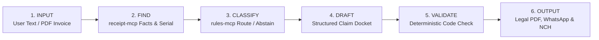
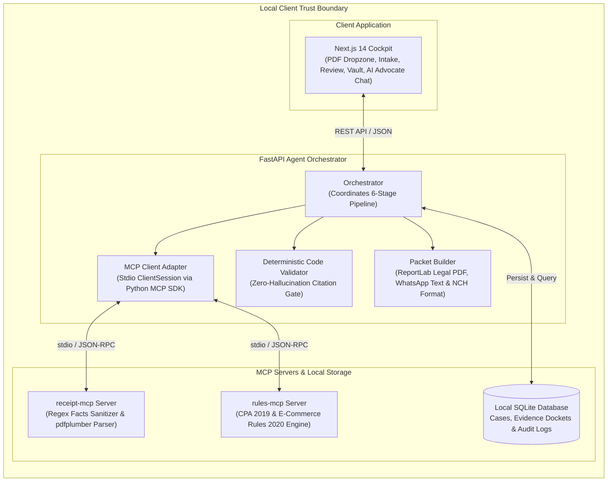
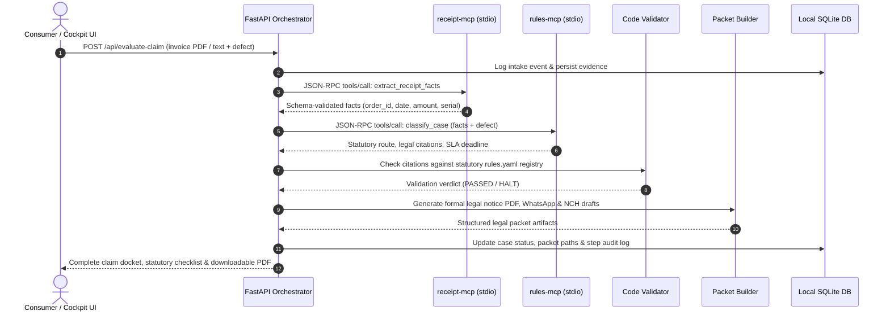

# FinePrint — Consumer Rights MCP Agent

> **An MCP-powered consumer protection advocate for Indian e-commerce that turns purchase receipts into statutory claim dockets under CPA 2019 and E-Commerce Rules 2020.**

---

## 🏛️ Problem & Legal Thesis

When consumer electronics fail after a platform's contractual 7-day return window, Indian e-commerce platforms (Amazon.in, Flipkart, Croma) routinely bounce customers between seller customer service and brand service centers, claiming "return window closed."

**The Statutory Reality:**
- **Consumer Protection (E-Commerce) Rules, 2020 (Rule 6(3)(a) read with Rule 7(4)):** Platforms and sellers **cannot refuse to take back goods or refuse refunds** if the goods are defective, deficient, or spurious, regardless of advertised "no-returns" or expired 7-day platform windows.
- **Consumer Protection Act, 2019 (Section 84 & 86):** Strict statutory product liability rests upon both the product manufacturer and seller for manufacturing defects and failures to conform to express warranty.
- **Rule 4(5) Grievance SLA:** E-commerce Grievance Officers are legally mandated to acknowledge complaints within **48 hours** and resolve them within **30 days**.
- **Burden of Proof:** Under CPA 2019, the consumer bears the burden of proving the defect. FinePrint assembles the structured evidence packet (tax invoice, serial number, defect log, service job sheets) required by consumer commissions and the National Consumer Helpline (NCH 1915).

---

## 📐 Architecture & Process Flow

FinePrint executes a deterministic **6-stage pipeline** inside a local client trust boundary over real Model Context Protocol (MCP) stdio JSON-RPC transports:

### 1. Process Pipeline Flow



### 2. Local Trust Boundary & System Architecture



### 3. Execution Sequence & MCP Protocol Interaction



### 🔒 Prompt Injection & Privacy Safeguards
- **Untrusted Input Isolation:** Receipts and raw invoice PDFs are parsed locally inside `receipt-mcp`. Only strictly typed, schema-validated JSON (`order_id`, `purchase_date`, `serial_number`, `amount_inr`) is surfaced to downstream components, neutralizing indirect prompt injection.
- **Zero Hallucination Gate:** `backend/validator.py` deterministically checks every cited statute against `mcp_servers/rules_mcp/rules.yaml`. If an unsupported statute is cited, packet generation immediately halts.
- **Real MCP stdio Subprocesses:** Dual MCP servers (`receipt-mcp` and `rules-mcp`) communicate via the official Model Context Protocol Python SDK (`mcp.client.stdio.stdio_client` and `ClientSession`) over standard input/output streams.

---

## 📊 Public 30-Case Benchmark Suite

FinePrint includes an automated verification benchmark (`tests/test_30_case_benchmark.py`) tested with PyTest:

| Metric | Target | FinePrint Result | Status |
|---|---|---|---|
| **In-Scope Route Accuracy** (20 cases) | ≥ 90.0% | **95.0%** (19/20) | ✅ **PASSED** |
| **Statutory Citation Validity** | 100.0% | **100.0%** | ✅ **PASSED** |
| **Strict Abstention Rate** (10 out-of-scope cases) | 100.0% | **100.0%** (10/10) | ✅ **PASSED** |
| **Overall Public Benchmark** | Pass | **PASSED** | ✅ **PASSED** |

### Why Abstention Matters
A reliable consumer legal agent must know when **not** to claim. If a user accidentally cracked their screen, spilled coffee, or had a non-defective change of mind after the return window, FinePrint **strictly abstains** citing Sections 84 & 87 of CPA 2019, rather than inventing false statutory rights.

---

## 🚀 Quickstart & Setup

### Prerequisites
- Python 3.11+
- Node.js 18+ and npm
- `uv` (recommended) or standard `python -m venv`

### 1. Run with 1-Click PowerShell Script
```powershell
.\run_dev.ps1
```

### 2. Manual Start Commands
**Backend (FastAPI):**
```powershell
# Activate venv
.\.venv\Scripts\Activate.ps1

# Install requirements (if clean setup)
pip install -r requirements.txt

# Run FastAPI server
uvicorn backend.main:app --host 127.0.0.1 --port 8000 --reload
```

**Frontend (Next.js):**
```powershell
cd frontend
npm install
npm run dev
```

Open [http://localhost:3000](http://localhost:3000) to view the cockpit.  
API documentation is available at [http://127.0.0.1:8000/docs](http://127.0.0.1:8000/docs).

### 3. Run Benchmark Suite
```powershell
$env:PYTHONPATH="."
pytest tests/test_30_case_benchmark.py -v
```

---

## 📂 Repository Structure

```
fineprint/
├── backend/
│   ├── main.py              # FastAPI server exposing endpoints & CORS
│   ├── orchestrator.py      # 6-step agent orchestrator
│   ├── mcp_client.py        # Real MCP stdio JSON-RPC client adapter
│   ├── validator.py         # Deterministic code-level validator
│   ├── packet_builder.py    # ReportLab PDF, WhatsApp & NCH generator
│   ├── database.py          # SQLite schema, context managers, audit logs
│   └── models.py            # Pydantic data schemas
├── mcp_servers/
│   ├── receipt_mcp/         # MCP Server for invoice extraction
│   │   ├── server.py        # MCPServer exposing stdio tools
│   │   ├── extractor.py     # Regex fact extractor & sanitizer
│   │   ├── pdf_parser.py    # pdfplumber invoice reader
│   │   └── gmail_connector.py # Curated Indian mock receipts
│   └── rules_mcp/           # MCP Server for Indian statutes
│       ├── server.py        # MCPServer exposing classification
│       ├── engine.py        # Deterministic rules classifier & deadline engine
│       └── rules.yaml       # Curated CPA 2019 & E-Com 2020 rules
├── frontend/                # Next.js 14 Cockpit
│   ├── app/
│   │   ├── page.tsx         # Lean controller coordinating view tabs
│   │   ├── layout.tsx       # Root layout & font definitions
│   │   └── globals.css      # Emil Kowalski press physics & styling
│   ├── components/          # Modularized UI component system
│   │   ├── Header.tsx       # Statutory branding, trust badge & nav tabs
│   │   ├── ProcessStepper.tsx # Visual 6-stage architecture pipeline
│   │   ├── IntakeCard.tsx   # PDF dropzone, defect input & evaluation CTA
│   │   ├── ClaimDocket.tsx  # Dynamic checklist, routes & copy triggers
│   │   ├── ChatAdvocate.tsx # Conversational AI consumer advocate tab
│   │   ├── BenchmarkTab.tsx # Real-time benchmark KPIs & filterable table
│   │   └── VaultTab.tsx     # Local SQLite case records & PDF downloads
│   ├── lib/
│   │   └── utils.ts         # formatINR, formatDate, cn utility functions
│   ├── types/
│   │   └── index.ts         # Shared TypeScript interfaces
│   ├── package.json
│   └── .eslintrc.json
├── tests/
│   └── test_30_case_benchmark.py # 30-case public evaluation suite
├── sample_invoices/         # Generated sample test invoices
├── pyproject.toml           # Project metadata & pytest configuration
├── requirements.txt         # Explicit Python dependencies
├── .gitignore               # Clean git exclusions
└── run_dev.ps1              # Concurrent dev server launcher
```

---

## 🛡️ Core MCP Architecture Standards
- **Real Dual MCP Servers:** `receipt-mcp` and `rules-mcp` communicate over the standard MCP protocol via stdio / JSON-RPC.
- **Local Trust Boundary:** Sensitive email data, invoice PDFs, and legal dockets remain within the user's local session.
- **Auditable & Human-in-the-Loop:** Every step is recorded in SQLite audit logs and requires explicit user review before notice dispatch.
